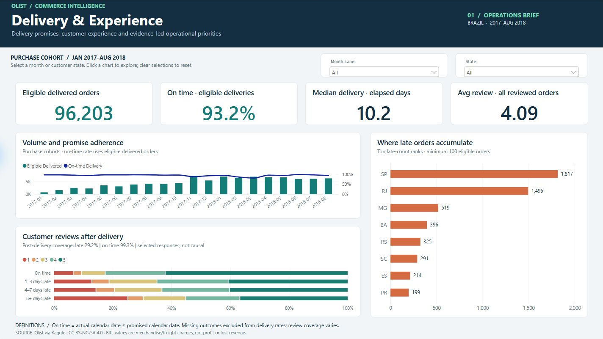
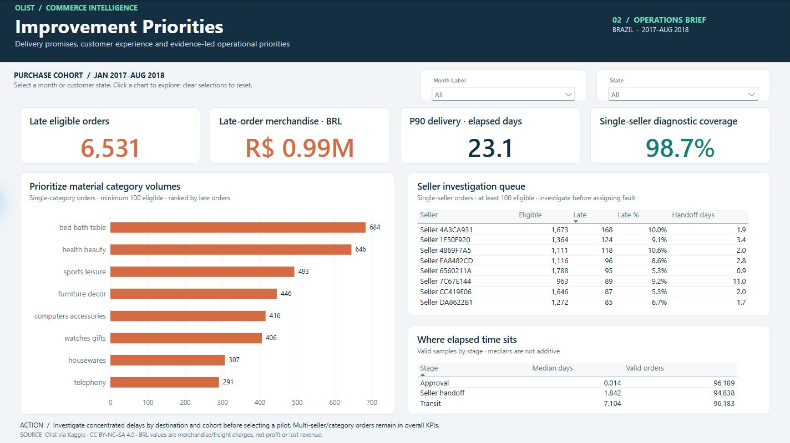
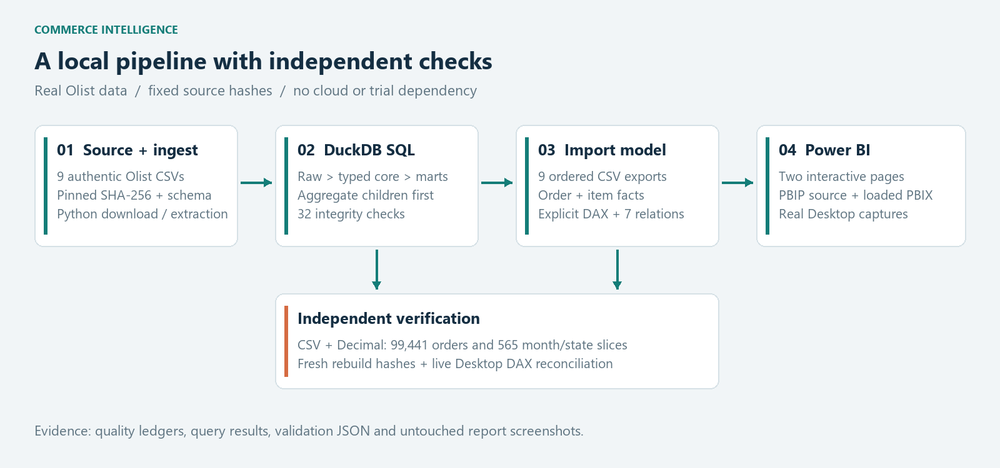

# Commerce Intelligence

**Which delivery promises are missed, where should operations investigate, and how does survey timing change the customer-experience story?**

An end-to-end analytics portfolio using authentic Olist marketplace data: **Python · DuckDB SQL · Power BI Import · DAX**. It turns **99,441 orders** into a tested order/item model, two interactive report pages and a management brief with evidence-based operational recommendations. The project runs locally without a Fabric trial or cloud service.

**[Open the interactive Power BI report — restricted access](https://app.powerbi.com/groups/me/reports/3024903c-5ef5-4b54-b097-dd8cfa57c3cd?ctid=9a97c27d-b83e-4694-b353-54bdbf18ab5b&pbi_source=linkShare)**

Microsoft sign-in and existing report permission are required. Anonymous viewing is currently unavailable in the hosting tenant; the public dashboard previews below require no account.

| Strongest verified finding | Business implication |
|---|---|
| **93.2% on time** across 96,203 eligible delivered orders, Jan 2017–Aug 2018 | Establish a precisely defined delivery baseline; this is not a success rate across all placed orders |
| **March 2018: 81.0%, versus 94.2% in other core months** | A 13.1 percentage-point gap persists after destination-state standardization; investigate cohort and promise-setting before assigning cause |
| **Post-delivery review coverage: 29.2% late vs 99.3% on time** | The rating comparison is strongly selected and cannot estimate the causal effect of lateness |



[Management brief — PDF](output/pdf/management_summary.pdf) · [Editable Power BI project](powerbi/CommerceIntelligence.pbip) · [SQL transformations](sql/02_marts.sql) · [Metric definitions](docs/model_and_metrics.md)

<details>
<summary><strong>View page 2 — Improvement Priorities</strong></summary>



</details>

The public release contains report **source and static previews**. To use the interactive report, generate the data locally and open the PBIP in Power BI Desktop. The populated PBIX and order-level data are excluded from the release. Preview images are pixel-exact canvas crops of genuine Desktop captures; no report content was reconstructed or altered.

## What makes this project credible

- **Grain before joins:** item, payment and review collections are aggregated separately before joining the one-order fact. The item fact remains available without multiplying order amounts.
- **Independent checks:** standard-library CSV, Decimal and datetime reconcile all 99,441 order rows and 565 month/state groups without reusing transformation SQL.
- **Real report validation:** Desktop import/refresh, saved-file reopen, live DAX reconciliation, slicer synchronization, chart filtering and genuine screenshots. JSON definitions alone are not treated as a working dashboard.
- **Critical interpretation:** 32 SQL integrity checks, source exception ledgers, review coverage, disjoint cohort comparisons and a destination-mix sensitivity check. No fabricated losses, causal effects or savings.

The default report period is **purchase cohorts January 2017–August 2018**. All source orders remain in the model. On time means actual delivery calendar date is no later than the promised date, among eligible delivered orders. Results describe historical marketplace data, not current business performance.

## Use the report

**Delivery & Experience** shows delivery volume, promise adherence, elapsed time, geography and selected review distributions. **Improvement Priorities** provides category and seller investigation queues and stage timing with valid sample sizes.

Month and customer-state slicers synchronize across pages. Click a chart bar to filter other visuals, then click it again to clear. Use the slicer eraser to reset. Diagnostics require at least 100 eligible orders, so narrow selections can yield an empty queue. Seller/category diagnostics exclude multi-seller/category attribution; overall KPIs retain those orders.

Review distributions include selected responses answered on/after delivery. The dynamic subtitle and tooltips expose coverage; hovering a score segment preserves the full band's low-rating share. Merchandise is item price excluding freight, with no refund adjustment. Late merchandise is **exposure**, not a revenue-loss estimate.

## Reproduce locally

Requires **Python 3.11+**, pip, and internet access for the pinned authentic Kaggle ZIP. Run from the repository root in PowerShell:

```powershell
python -m venv .venv
.\.venv\Scripts\python.exe -m pip install -r requirements.txt
.\.venv\Scripts\python.exe src\run.py
```

An existing original ZIP can be supplied with `--archive C:\path\olist.zip`. Archive/file hashes and schema are checked; changed source bytes fail rather than silently updating findings. Raw data, generated CSVs, local databases and caches are ignored by Git.

**Close Desktop before regenerating its project files.** Run the pipeline before opening the published PBIP: its DataRoot parameter is deliberately a setup placeholder. Open the generated PBIP, choose **Transform data > Close & Apply**, then **Refresh** and save. The pipeline generates data and PBIP definitions; it does not automate the binary PBIX build. Use **File > Save as > Browse this device** to save your own PBIX. See [setup, tests and known Desktop synchronization behavior](docs/validation.md).

```powershell
.\.venv\Scripts\python.exe tests\reproducibility.py
.\.venv\Scripts\python.exe tests\test_validation_guards.py
```

Schema checks require `requirements-dev.txt`; optional PDF/diagram authoring requires `requirements-artifacts.txt`. A [clean-room reproduction test](tests/cleanroom.py) exercises the complete pipeline from an empty output directory. Desktop tests require Windows Power BI Desktop and are separate from Python checks.

## Inspect the implementation



| Technical entry point | What to inspect |
|---|---|
| [Staging SQL](sql/01_staging.sql), [mart SQL](sql/02_marts.sql) | Types, deterministic latest review, child aggregation, order/item grain |
| [Integrity checks](sql/03_tests.sql) | Null contracts, relationship integrity, monetary reconciliation and date consistency |
| [Analytical queries](sql/analysis), [independent cohort audit](src/audit_findings.py) | Cohort denominators, rates, sensitivity checks and selection bias |
| [Model and metrics](docs/model_and_metrics.md), [DAX dictionary](docs/measure_dictionary.json) | Seven one-direction relationships, 36 explicit measures and metric populations |
| [Evidence](reports/validation), [Desktop results](reports/powerbi) | Actual machine-readable results; mutation tests for false-PASS conditions |
| [Management summary](reports/management_summary.md), [interview guide](docs/interview_guide.md) | Findings, pilot proposals, CV wording and technical walkthrough |
| [Validation procedure](docs/validation.md), [release notes](RELEASE_NOTES.md) | Reproduction steps, actual Desktop checks and release boundaries |

## Source and attribution

**Olist Brazilian E-Commerce Public Dataset**, provided by Olist via [Kaggle](https://www.kaggle.com/datasets/olistbr/brazilian-ecommerce), under [CC BY-NC-SA 4.0](https://creativecommons.org/licenses/by-nc-sa/4.0/). Changes include cleaning, deterministic review selection, aggregation, diagnostics and visualization. Retain attribution, indicate changes and observe the noncommercial/share-alike terms; see [DATA_LICENSE.md](DATA_LICENSE.md).

This is an unpaid educational portfolio. Dataset-derived findings, screenshots and the management brief retain the source's noncommercial/share-alike terms. No commercial-use permission or endorsement is implied. Third-party dependencies and Microsoft resources retain their own rights. There is no affiliation with Olist or any prospective employer.

## Authorship and limits

AI assisted with implementation, report definitions, testing and documentation. The repository demonstrates a working artifact; personal proficiency must be demonstrated separately. The [interview guide](docs/interview_guide.md) identifies the SQL, DAX and analytical concepts to defend.

This historical observational analysis does not identify a logistics cause, establish a causal rating effect or quantify savings. Carrier events, promise revisions, actual costs and refunds are unavailable. The proposed business outcome is a better-targeted investigation and pilot, not a claimed operational improvement.
